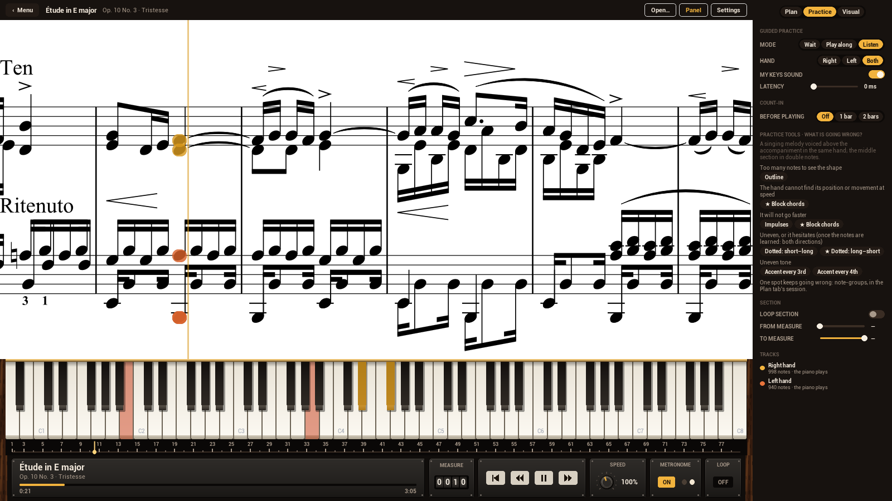
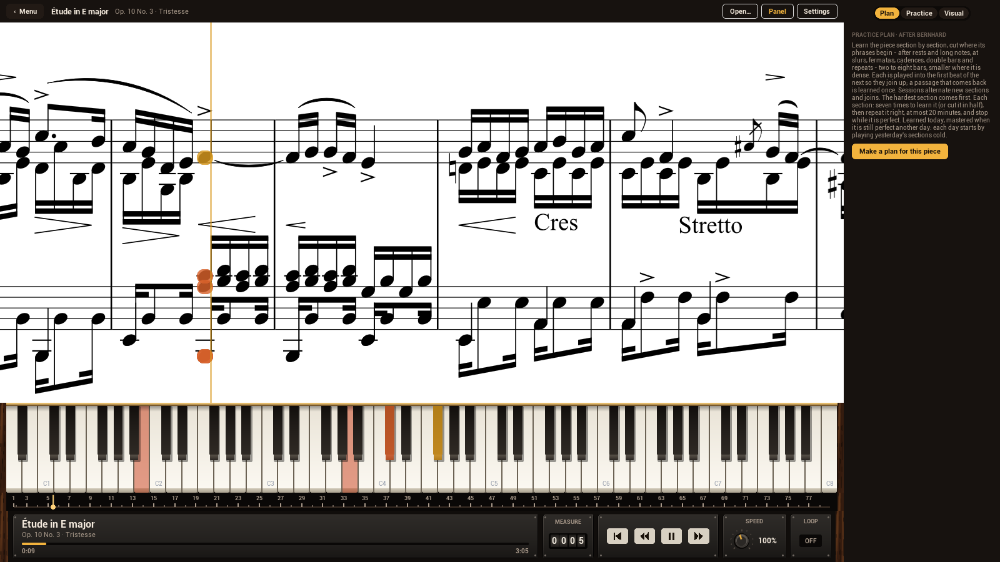
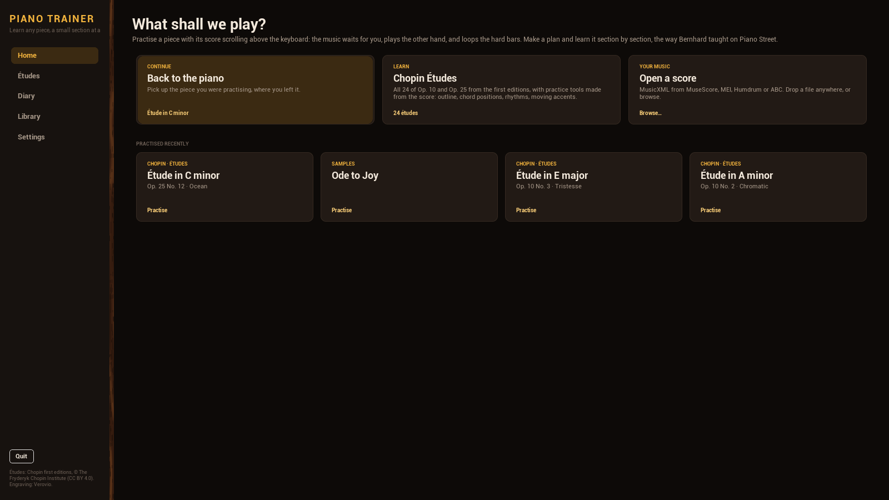
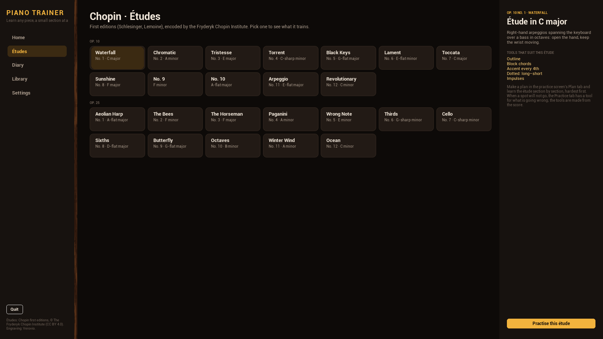
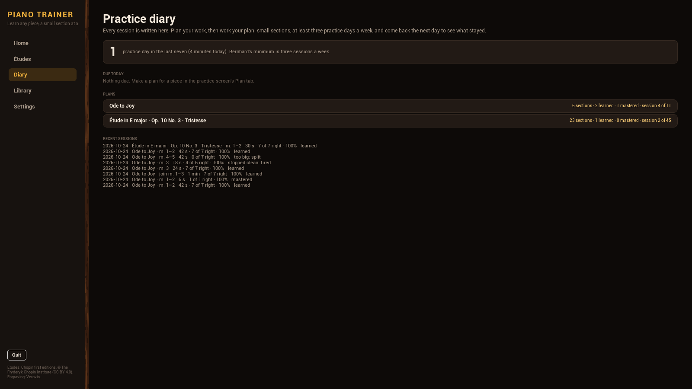
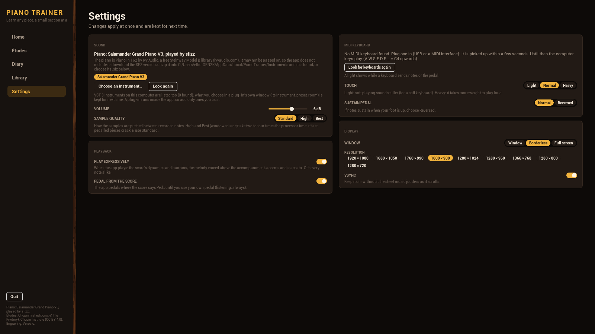
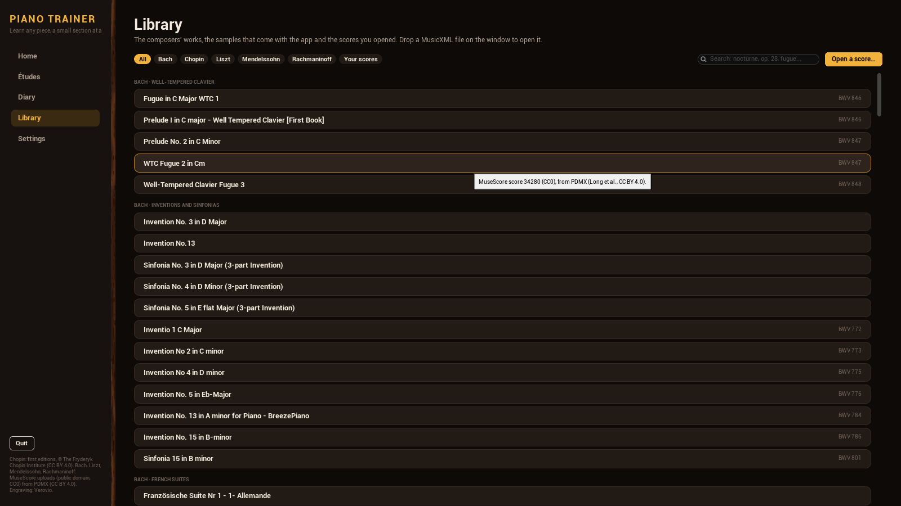

# Piano Trainer

A piano learning app for **Windows and macOS**, built natively in **Unreal Engine 5.8**: load a score (MusicXML from
MuseScore / musescore.com, MEI, Humdrum, ABC), read it as large, scrolling sheet music above a keyboard, and play
along on a MIDI keyboard (or the computer keyboard). It **waits for you** until you play the right notes, plays the
other hand for you, loops the hard bars, and scores your timing.

On top of the practice screen it has:
- a **practice plan after Bernhard's method** (Piano Street forum): the piece cut into small sections, the
  seven-times test, "practice starts when you get it right", stop while it is perfect, 20 minutes at most per
  section, joins between sections, learned → mastered → never forgotten, and a **practice diary**;
- **Chopin's 24 Études** (Op. 10 and Op. 25, from the first editions) and **practice tools made from the score**,
  listed by what is going wrong: outline, the chord trick, impulse groups, rhythm variations, moving accents;
- **expressive playback** when it plays for you: the score's dynamics, hairpins, accents and pedal marks, the melody
  voiced over the accompaniment;
- **any piano you like**: an SFZ sample library (Piano in 162 recommended) played by sfizz, or **any VST 3
  instrument** with its own window (Pianoteq, Garritan's ARIA Player, sfizz's plug-in...);
- **a library of the composers' works**, fetched by scripts under open licences: Chopin's solo piano works from
  his first editions (155 pieces, the Chopin Institute, CC BY 4.0) and, from MuseScore uploads in the public domain
  or CC0 (PDMX), the best of Bach's keyboard works (48), Liszt (31), Rachmaninoff (15) and Mendelssohn (7).

| | |
|---|---|
|  |  |
| Practice: Op. 10 No. 3 playing, the Practice tab with the tools by problem | The Plan tab before a plan is made |
|  |  |
| Home | The 24 Études and what each trains |
|  |  |
| The practice diary | Settings: sound, plug-ins, MIDI keyboard, display |
|  | |
| The Library: composers, collections, search; each piece's edition and licence on hover | |

(`tools/take_screenshots.ps1` takes them again.)

| Piece | What it does |
|---|---|
| **Verovio 6.3.0** (LGPL, separate DLL/dylib) | Engraves the score as one long system and gives every note's pitch, onset and duration. Patched: Humdrum key-signature accidentals (see below). |
| **lunasvg 3.5.0** (MIT, static) | Rasterises Verovio's SVG into texture tiles on a background task; finds each notehead and staff. |
| **sfizz 1.2.3** (BSD-2, separate DLL/dylib) | The piano: plays an SFZ sample library's own file (velocity layers, release noises, string resonance, pedal noises, the damper) with up to 256 voices (the quietest give way first), streaming the samples from disk. |
| **Piano in 162** (Ivy Audio, free, not redistributable) | The recommended piano: a Steinway Model B, SFZ. Not shipped: you download it from ivyaudio.com and unzip it into the Instruments folder (Settings > Sound shows where). Any other SFZ works too. |
| **VST 3 SDK 3.8.1** (MIT, Steinberg; `Plugins/PianoKit/Source/PianoVst3`) | Hosts any VST 3 instrument instead of sfizz: the hosting part of the SDK compiled into its own module, the plug-in's window over the app, what you set in it kept per plug-in. |
| **Chopin first editions** (CC BY 4.0, Fryderyk Chopin Institute) | Études Op. 10 and Op. 25 in Humdrum `**kern` (`tools/fetch_etudes.py`). |
| **PianoKit Sequencer** (our MetaSound node) | The practice engine on the audio thread: accompaniment, your keys, wait mode (the clock stops exactly at the next chord), play-along scoring (±220 ms, latency-compensated), count-in clicks, tempo, seek, loop. |
| **PianoKit Sfizz** (our MetaSound node) | Feeds the sequencer's MIDI stream into sfizz sample-accurately and renders it; also the count-in clicks. |
| **Harmonix** / **MIDI Device Support** (Epic plugins) | MIDI stream types between the nodes; every connected MIDI keyboard is bound automatically (CC64 = sustain pedal). |
| Slate UI (`Source/PianoTrainer/UI`) | Menu, practice screen, sheet strip, keyboard, optional falling notes, sidebar (Plan / Practice / Visual), transport, practice coach. No editor assets are needed: the MetaSound graph is built in code. |

## Using it

**Menu.** *Home*: continue, the Chopin Études, open a score, and the pieces practised recently. *Études*: each
étude's key, nickname, what it trains and the tools that suit it. *Diary*: practice days in the last week, what is due
today (sections to check or play through, pieces to relearn), each plan's progress and the latest sessions; click an
item to practise it. *Library*: every piece by composer and collection (Bach · Well-Tempered Clavier, Chopin ·
Nocturnes...), a chip per composer and one for your own scores (samples, recent files), a search box (title, opus,
collection), and each piece's edition and licence on hover. *Settings* (also the top bar's Settings
button): the piano (an SFZ or a VST 3 plug-in, *Open its window* for the plug-in's own controls, volume, sample
quality), playback (play expressively, pedal from the score), the MIDI keyboards seen (a light shows while one sends),
touch (velocity curve), a reversed sustain pedal, and the window (window / borderless / full screen, resolution,
VSync); everything is kept for next time. *Quit* leaves the app. `Esc` toggles the menu.

**Sound.** When the app plays (the other hand, or everything in *Listen* - the hand chooser picks which hands it
plays), it plays the score's dynamics and hairpins (a "poco a poco cresc." drawn as several hairpins reaches the next
written dynamic at the last one), accents, staccato and tenuto, voices a chord's top note over the rest and the bass
under it (an arpeggio stays even), and pedals where the score says *Ped.* until you use your own pedal. Pianos come
from `Instruments` folders (`<user data>/PianoTrainer/Instruments` and next to the app), any `.sfz` or `.vst3` chosen
in Settings, and the system's VST 3 folders (`Common Files\VST3`, `/Library/Audio/Plug-Ins/VST3`). A plug-in runs
inside the app, so add only ones you trust; what you choose in its window (its instrument, preset, room) is saved per
plug-in when the window closes and when the app quits, and restored when it loads.

**Practice screen.** Sheet music on top (two thirds of the window; all of it when the falling notes are off), the
keyboard under it, the measure ruler (click a measure to jump, drag across measures to loop them; the plan's sections
run along its top - grey new, gold learned, green mastered, paler for a passage that comes back - and can be edited
there: drag an edge to move it, onto the next edge to merge, double-click a section to split it at that bar) and the
transport bar (piece and progress, measure
counter, restart / measure back / play-pause / measure forward, speed knob, metronome, loop) at the bottom, and the
sidebar. The metronome clicks lightly on every beat of the score while the music plays (beat 1 of the bar accented,
silent while wait mode holds the clock), and its two lights flash with it: gold on beat 1, white on the others. The
sidebar:
- *Plan tab* (the first): the practice plan (below).
- *Practice tab:* mode (**Wait** for me / **Play along** / **Listen**), hand, my keys sound, input latency, count-in
  (1 or 2 bars of clicks), **practice tools** by problem (★ = suits this étude; the accent tools also report how
  much louder you played the accents, from MIDI velocity), loop section, and the two hands' note counts.
- *Visual tab:* sheet music, falling notes (off by default), sparks, colour by hand, how long notes fall.

Colours: the right hand is gold, the left copper; notes you play turn green, missed ones red; the hand the app plays
for you is dimmer. On the keyboard the next keys glow in their hand's colour, held keys turn green when right and red
when wrong.

Keys: `Space` play/pause, `Backspace` restart, `↑`/`↓` tempo, `←`/`→` seek 2 s, `1`/`2`/`3` right/left/both,
`Q` wait mode, `V` listen, `M` my keys sound, `Ctrl+O` open. No MIDI keyboard? `A W S E D F T G Y H U J K O L P ;`
= C4 to E5, `Z`/`X` octave, `Left Shift` = sustain pedal; or click the keys.

Open a score with `Ctrl+O`, the menu, or by dropping a file on the window: `.musicxml` `.xml` `.mxl` `.mei` `.krn`
`.abc`; `.mscz`/`.mscx` are converted with MuseScore Studio's command line if it is installed.

### The practice plan (after Bernhard)

Bernhard, a teacher on the Piano Street forum (2003-08), described a way of learning a piece in many posts; the
app's Plan tab applies it (`docs/bernhard-method.md` collects the sources):

- **Sections at phrases.** Bernhard plans the chunks from the music's structure and lets the seven-times test decide
  when one must be smaller. *Make a plan* reads the score (`FPianoPhrases`): every beat scores as a phrase start for
  a rest in the melody before a new note, the melody's long last note (twice its neighbours, longer than what
  follows; the melody is the top line of the right hand, above any inner voice), a slur or phrase mark a bar or
  longer ending or starting, a fermata, a double bar or repeat sign, a cadence (the bass under that last note on the
  tonic or dominant of the key), a passage that comes back note for note, a bar line (a little), and against cutting
  through held notes. The cut is the cheapest path through the beats: sections of two to eight 4/4 bars (whatever
  the metre), smaller where the music is dense (over 32 onsets), at the strongest starts. A passage that comes back
  note for note is learned with its original (its single session is skipped, its progress follows). Each section
  is practised with the first beat of what follows, so that the sections join up.
- **Your phrases.** The plan is a draft: on the ruler, drag an edge between two sections to move it (it snaps to
  bar lines), drag it onto the next edge to merge the two, double-click a section to split it at that bar. Sections
  whose notes change start again as new. *Cut again at phrases* makes the plan afresh and keeps the progress of
  every section that stays the same.
- **Sessions.** New sections and joins alternate: 1, 2, 1–2, 3, 1–3, 4, 1–4, 5, 2–5, ... (a join spans at most four
  sections). The NEXT card starts the next one; any section can be started from the list.
- **The seven-times test.** A session loops its section at tempo with a one-bar count-in. Not right once in seven
  times? The section is too big: *Cut in half* splits it at the strongest phrase start near its middle (down to a
  single beat) and starts again on the first half.
- **Practice starts when you get it right.** After the first clean pass, play it right at least seven times and at
  least as often as it went wrong before. A mistake after it was right is fatigue: the coach says so.
- **Hands separately, then together.** Technique is found with each hand alone (mistakes made hands together go
  into hand memory), coordination hands together. *Hands: Auto* (the default) plays the section together first and
  only goes to separate hands if that is not right, as Bernhard allowed; *Separate first* always does; *Together*
  never does. Separately, the hands take turns after a bar of clicks: right three times in a row, then the other
  hand, then twice each, then once each, never more than half a minute on one hand (the busier hand starts). Each
  hand has its own seven-times test. When both hands are right once each in turn, they join in the same session.
  Joins of sections are always together, and so is the next day's check (only if that fails do the hands go
  separately again).
- **Stop while it is perfect.** The session ends on a clean repetition: the section is *learned*.
- **20 minutes at most** per section (a timer): not there by then, cut it in half.
- **Mastered.** On a later day, the first time through a learned section decides: perfect straight away = mastered;
  otherwise practise it again (it goes faster than the first time). Mastered sections are due for a play-through
  when they have not been played for three days.
- **Never forgotten.** A month or more after a mastered section was last played it is relearned from scratch; after
  the third relearning it is *omniscient*.
- **Note-groups.** For a stubborn spot: units of four notes of the practised hand, overlapping by one, played as
  1, 2, 3, ... then 1–2, 2–3, ... then longer, each twice right, up to the whole section.
- **Tempo.** Aim at the final tempo or faster (70 / 85 / 100 / 110 % chips); the best clean tempo is kept per
  section. Slow work belongs to the practice tools (outline, rhythms), not to the session.
- **Diary.** Every session is written to `Saved/PianoDiary.json` (date, section, minutes, passes, clean ones, tempo,
  result); the Diary page counts practice days (Bernhard: at least three a week).

### Practice tools

Bernhard's rule: start from the problem, not from a method. The Practice tab lists the tools by what is going wrong
in the looped bars; each one is generated from the score and re-times or re-accents the practised hand's notes inside
each beat (the accompaniment stays as written, so the sheet and the measure counter stay in step). Click a tool
again to play as written.

| Problem | Tool | What changes |
|---|---|---|
| Too many notes to see the shape | Outline | only each beat's first note, held through the beat: learn the line first, the figuration fills it in later |
| The hand cannot find its position or movement at speed | Block chords (the chord trick) | each beat's notes struck together, the fastest they can be played; then break them again |
| It will not go faster | Impulses, block chords | each beat as one quick gesture in its first third, then held: bigger units |
| Uneven, or it hesitates | Rhythms short–long / long–short | each pair in a beat becomes 1:3 / 3:1; always both directions, and only once the notes are learned |
| Uneven tone | Accent every 3rd / 4th | accents that walk across the beat (velocity +30) |
| One spot keeps going wrong | Note-groups | in the Plan tab's session (above) |

The same kinds of exercise are in Alfred Cortot's working editions of the Études (1915-17), which Bernhard also
recommended; those exercises are still under copyright in Europe, so nothing of them is used here.

## Getting the sources and data

Nothing large is in git; scripts fetch it, pinned by hash or size:

```
py -I tools/fetch_thirdparty.py     # Verovio 6.3.0, lunasvg 3.5.0, sfizz 1.2.3 sources (~26 MB) -> ThirdParty/src
py -I tools/fetch_etudes.py         # Chopin Études, 24 Humdrum files, ~0.6 MB -> Scores/Etudes/Chopin
py -I tools/fetch_library_chopin.py # Chopin's solo works, 157 first-edition Humdrum files, ~4 MB -> Scores/Library/Chopin
py -I tools/fetch_library_pdmx.py   # Bach, Liszt, Mendelssohn, Rachmaninoff from PDMX: downloads PDMX.csv (225 MB) and
                                    # mxl.tar.gz (1.89 GB, MD5-checked) to E:/modding/downloads/pdmx (--downloads <dir>),
                                    # keeps ~100 MusicXML files -> Scores/Library/<Composer>; --list shows the choice
```

The library's scripts write a `catalog.json` per source (composer, collection, title, opus, credit; the app lists
from it without opening the files) and then load every piece through Verovio (`tools/check_library.py --prune`):
a piece that does not load is left out of the catalog and named in `skipped.json`. Chopin: one first edition per
piece (the edition that has most of its opus), without the Études (they have their own page) and the works with
orchestra, chamber music, two pianos and songs; the two posthumous polonaises (G minor, G-sharp minor) stop Verovio
6.3's Humdrum import on an assertion and are left out. PDMX: no curated open edition of Bach, Liszt, Mendelssohn or
Rachmaninoff exists in a format Verovio reads (the encoded corpora are non-commercial or reserve their rights), so
the script takes MuseScore uploads without licence conflicts, solo piano, no lyrics, the composer's own piano works
(Bach: BWV 772-994, the notebooks, 999, 1080), no arrangements, jokes or annotated copies, rated 4.5+ or viewed
300+ times, one per work (catalogue number, number and movement, or a nickname). Their quality varies.

The piano samples are not fetched: Piano in 162 may be used but not passed on, so download its SFZ version from
ivyaudio.com and unzip it into `<user data>/PianoTrainer/Instruments` (on Windows
`%LOCALAPPDATA%\PianoTrainer\Instruments`). Without samples the app plays a plain tone. The VST 3 SDK's hosting
sources are in the repo (`Plugins/PianoKit/Source/PianoVst3/sdk`, MIT).

## Building

Engine: UE 5.8. Windows needs Visual Studio 2026 with the C++ workload; macOS needs Xcode. No CMake.

1. Third-party libraries: `ThirdParty\build_win64.bat` (plain `cl`; `build_win64.bat sfizz` rebuilds only sfizz)
   or `ThirdParty/build_mac.sh` (universal arm64 + x86_64 `clang`). Both apply `ThirdParty/patches` first and put
   the results in `Plugins/PianoKit/ThirdParty`.
2. Editor build (Windows):
   `<UE>\Engine\Build\BatchFiles\Build.bat PianoTrainerEditor Win64 Development -Project="<path>\PianoTrainer.uproject"`
3. Run: `UnrealEditor.exe PianoTrainer.uproject -game -windowed -resx=1600 -resy=900`
4. Package (shipping):
   `RunUAT.bat BuildCookRun -project="<path>\PianoTrainer.uproject" -platform=Win64 -clientconfig=Shipping -build -cook -stage -pak -archive -archivedirectory="<path>\Packaged" -noP4 -unattended`
   sfizz, Verovio and its data, and `Scores/` are staged as loose files next to the app (no piano samples).

macOS: `./ThirdParty/build_mac.sh`, then `Build.sh PianoTrainerEditor Mac Development -Project=...` and
`RunUAT.sh BuildCookRun ... -platform=Mac` from your UE 5.8 install. sfizz and Verovio are loaded with `dlopen` and
their functions looked up by name (`SfizzApi.cpp`, `VerovioApi.cpp`), so no rpath setup is needed. The VST 3 host's
Mac parts (`PianoVst3/Private/Mac`: the SDK's bundle loader, an NSWindow for the plug-in, plug-in calls moved to the
main thread) are written but have not been compiled yet. (Not yet tried on a Mac.)

The optional engine-rendered stage (`-keyboard3d`: a 3D keyboard and a falling-notes highway with bloom) needs two
materials made by a commandlet: `UnrealEditor-Cmd.exe PianoTrainer.uproject -run=PianoAssetBuilder -unattended -nullrhi`.

### Patches to third-party code

- **Verovio, Humdrum import** (`ThirdParty/patches/verovio-6.3.0-humdrum-gestural-accidentals.patch`): accidentals
  implied by the key signature were neither drawn nor stored as performed accidentals, so every `**kern` file sounded
  (and was judged) without its key signature — Op. 10 No. 5 "Black Keys" came out on white keys. The patch keeps them
  as `accid.ges`. MusicXML is not affected.
- **sfizz voice cap** 256 → 1024 (`config::maxVoices`; every use is a capacity), applied by the build scripts.

## Testing with data

`tools/run_tests.ps1` runs the battery below (each test plays itself and writes `Saved/PianoLogs/tests/<name>.json`,
plus a `.wav` where it records); `-Exe` points it at a packaged build, `-Only a,b` picks tests (run it with
`powershell -Command "& tools/run_tests.ps1 -Only a,b"`), `-Stress <score>` adds a 200 % listen run of a long, dense
piece.

- `-autotest` plays the practised hands perfectly, then writes `Saved/PianoLogs/autotest.json` (expected / hits /
  wrong / missed / waits / timing error / frame times / scroll smoothness) and quits. With `-wait=0|1`,
  `-hands=right|left|both`, `-tempo=0.8`, `-score="path"`, `-start=` / `-stop=<ms>`, `-autoerrors=N` (every Nth
  note a semitone off), `-drill=outline|longshort|shortlong|impulses|blockchords|accent3|accent4`, `-countin=<bars>`,
  `-recordwav` (master output to `autotest.wav`), `-shot=<ms>` (screenshot), `-pianolog` (event CSV).
- `-coach=<n>` / `-coach=s<k>` (with `-autotest`) runs session *n* of the piece's plan, or section *k* alone, until
  the coach says done or too big, and adds the coach's phases, passes, the section's stage and the diary to the
  report; `-coachgroups` starts note-groups, `-coachsplit` cuts a too-big section in half,
  `-coachhands=auto|separate|together` sets the hands choice for the run (default auto, whatever you saved),
  `-autoerrorsuntil=N` keeps the autoplay's mistakes to its first N notes, `-diary=<file>` keeps the test's diary
  apart from yours. The battery runs learn → next-day check (the learned date moved back a day) → join → note-groups
  → stop when tired → too big + split → relearn after 40 days → hardest first, then the hands tests on a fresh diary.
- `-plantest=report|edit` makes the score's plan in the diary given with `-diary=` and writes its sections and the
  phrase cues (beat, strength, reasons) and slurs to `Saved/PianoLogs/plantest.json`; `edit` then edits the plan on
  the ruler with real mouse events routed by Slate (drag the first edge to bar 4, double-click bar 11, drag that edge
  back onto bar 9) and cuts the last section in half, recording the plan after each step. `tools/make_phrase_score.py`
  writes the test score, `Scores/test_phrases.musicxml`, whose phrases are known: A (m. 1-4, slurred, ending on a
  long note and a rest), A again (5-8), a figuration between repeat signs (9-12, played twice: 13-16), a phrase
  ending on a fermata (17-18.3) and one starting on an upbeat (18.4-20). The coach tests start from a fixed plan for
  Ode to Joy (m. 1-2, 3, 4-5, 6-7, 8) written by the battery.
- `-uishot=<s>` saves a screenshot of whatever is on screen (the menu too) and quits;
  `-menupage=etudes|diary|library|settings` and `-sidebartab=practice|plan|visual` open the app on that page or tab.
- Sound: `-quiet` (the battery always passes it: nothing from the speakers, the recording is taken before the main
  output's volume), `-listen`, `-instrument=<.sfz or .vst3>`, `-expressive=0|1`, `-scorepedal=0|1`, `-metronome=0|1`, `-quality=N`
  (sfizz interpolation), `-voices=N`, `-instrumentcc=20:0,21:0` (instrument controls, 0..1), `-audiostats` (each
  second: the instrument's render time against the block, the longest gap between blocks, voices, peak, limiter, pedal
  and note messages), `-mididump` (every message the instrument gets, and its voices after each block, to
  `Saved/PianoLogs/mididump.csv`), `-pluginwindow` (opens the plug-in's window, closes it, checks its state was kept).
- `tools/build_test_vst3.ps1 -Sdk <clones>` builds mda Piano (the SDK's MIT sample, with a plain editor window added)
  as `Saved/TestPlugins/mdaPiano.vst3`, the real VST 3 instrument the `vst3_*` tests load. The script fixes one bug in
  the sample: a note exactly at the end of one of its 16-frame slices was dropped (round score times at 48 kHz land
  there: 9 of the Ode's 19 onsets).
- `tools/check_library.py [source]` loads every library piece through Verovio, each in its own process (an assertion
  in Verovio ends the process, and would end the app), and reports failures; `--prune` also drops them from the catalog.
- `tools/wav_clicks.py`, `wav_levels.py`, `wav_onsets.py` measure recordings; `tools/expression_report.py` compares
  velocities and loudness with and without expression; `tools/vrv_probe.py` runs a score through Verovio outside UE;
  `tools/take_screenshots.ps1` takes the screenshots above.

Results on Windows 11, editor build `-game`, 1600×900 (2026-10-24; frame p99 is under 3.1 ms and no frame took
over 33 ms in any run):

| Test | Outcome | Notes |
|---|---|---|
| `plan_phrases` | all PASS | made m. 1–4, 5–8 (= 1–4), 9–12, 13–16 (= 9–12), 17–18.3, 18.4–20; the ruler edits give 1–3 / 4–8, then 9–10 / 11–12, then 9–12 again; cut in half: 18.4–19 / 20 |
| `plan_ode` | PASS | m. 1–4, 5–8 |
| `plan_10_2` | report | 24 sections of 2 bars (one of 3), returning bars learned once (5–6, 9–10, 13–14, 40–41 = 1–2) |
| `plan_10_3` | report | 23 sections of 0.75–2.5 4/4 bars (it is in 2/4); its slurs are short articulation, so it is cut at long notes and cadences |
| `ode_wait` | finished | 45/45 hits, 0 wrong, 0 missed, timing error 9.4 ms |
| `ode_drill_ls` / `ode_drill_acc` | finished | 45/45 each; the accent drill measured +48 velocity on the accents |
| `ode_outline` | finished | 42/45: one note per beat, the rest silent |
| `ode_countin` | stopped at 6 s | clicks at 0, 0.6, 1.2, 1.8 s, the first chord at 2.41 s (from the recording) |
| `etude_10_5` (right hand) | stopped at 20 s | 230 hits, 0 wrong, 0 missed (G♭ major: the key-signature patch) |
| `coach_learn` | done | m. 1–2: 7 times through, right from the first, 7 right → learned |
| `coach_cold` | done | learned "yesterday", perfect the first time → mastered after 1 pass |
| `coach_join` | done | join m. 1–3, 7 right |
| `coach_groups` | done | note-groups 1, 2 (twice right each), then the whole section, 7 right |
| `coach_tired` | done | right, then mistakes came back twice → stopped on the next clean pass (4 of 6 right) |
| `coach_toobig` | split | hands together, wrong every 3rd note: 7 times and never right → too big → cut in half (5 → 6 sections) |
| `coach_relearn` | done | mastered, last played 40 days ago, relearned for the third time → omniscient |
| `coach_hardest` | done | Op. 10 No. 3 cut at phrases: no section is clearly the hardest, so it starts at m. 1–2, 7 right (the phrase test score starts at its dense m. 9–12) |
| `coach_hands_auto` | done | two mistakes together → right hand alone R3, left L3, R2, L2, R1, L1 → together, 7 right |
| `coach_hands_sep` | done | separate first: R3 L3 R2 L2 R1 L1 → together, 7 right, 0 wrong |
| `coach_hands_toobig` | too big | every note wrong at 40 %: each hand's turn ends at half a minute (R, L), then the right hand's 7th wrong time → too big |
| stress (Chopin, 200 %, listen) | finished | 3168 notes, 0 frames over 33 ms, smooth-scroll jitter p99 1.66 ms |
| `vst3_ode` | PASS | the Ode played by mda Piano through the VST 3 host (sustain pedal mapped, recorded) |
| `vst3_window` | PASS | its window opened at the size it asked (480×240), closed, its state saved (1016 bytes) and restored the next run |

**Sound** (Op. 25 No. 12 in full, listening, Salamander SFZ, editor build). The crackle was the audio thread running
out of time: sfizz needed 12-17 ms for each 10 ms block once 1024 voices played, and the loud end clipped (peak
1.54). Now (256 voices, Standard quality, 256-frame MetaSound blocks matching the device buffer, a -1 dBFS limiter,
-6 dB default level): 2.0 ms per 5.3 ms block, no underrun while playing, peak 0.83, limiter idle. Why so many voices:
each lift of the pedal starts the library's release samples (string resonance, hammer) for every note released under
it - 60 to 90 in this étude - and sfizz only cuts an older one on the same key for a louder new one, so they pile up;
without the pedal the voices stay at 120-150. A standalone replay of the app's own MIDI (`-mididump`) through the same
sfizz library gives the same counts block by block. Expression: f holds for the first 45 s, the three crescendos climb
to fff by the last one and fff holds to the end; arpeggio notes stay even, accented melody notes stand ~20 velocity
above them.

The Shipping package gives the same results for `ode_countin` (same click and note onsets in its recording),
`etude_10_5` and `coach_learn`. A packaged build keeps its `Saved` folder (reports, diary) in
`%LOCALAPPDATA%\PianoTrainer\Saved`; `run_tests.ps1 -Exe <packaged exe>` reads it from there.

## Layout

```
PianoTrainer.uproject
Config/                      audio buffers (256 frames x 3), cooking
docs/                        bernhard-method.md: the practice method the plan follows, with sources; screenshots/
Plugins/PianoKit/
  Source/PianoKit/           FPianoScore (Verovio + lunasvg), FPianoSession, sequencer + instrument MetaSound nodes,
                             UPianoPlayer (graph, sound, MIDI, feedback, drills, loop passes, async score loading),
                             FPianoExpression (velocities from the score), FPianoDrills, FPianoLibrary,
                             FPianoPhrases (phrase starts), FPianoPlan + FPianoDiary (practice plans and diary)
  Source/PianoVst3/          FPianoVst3Plugin: VST 3 hosting (load, notes, controllers, render, window, state);
                             sdk/ = the VST 3 SDK's pluginterfaces + hosting sources (MIT)
  Source/PianoKitEditor/     PianoAssetBuilder commandlet (materials for -keyboard3d)
  ThirdParty/                built libraries (not in git)
Source/PianoTrainer/
  UI/                        SPianoApp, SPianoHome, SSheetStrip, SPianoKeyboard, SFallingNotes, SPianoSidebar,
                             SPianoPlanPanel, FPianoCoach, SPianoTransport, SPianoRuler, SPianoHud, PianoWidgets,
                             PianoStyle
  Piano3D/                   optional engine-rendered keyboard + note highway (-keyboard3d)
Scores/                      sample scores, Etudes/Chopin and Library/<source> with its catalog.json (fetched)
ThirdParty/                  build scripts and patches; src/ and build/ are local
tools/                       fetch scripts, test battery, test VST 3 build (test_vst3/), screenshots, score
                             generators, wav analysis, vrv_probe
```

## Open items

- Not yet tested: a real MIDI keyboard and its pedal, the macOS build (and its VST 3 window), Piano in 162 itself
  (its controls, e.g. the room blend, are not in Settings yet), and VST 3 plug-ins other than the test one.
- VST 2, AU and CLAP plug-ins are not hosted (VST 2 cannot be with open-source code).
- The three Nouvelles Études are not included: no openly licensed machine-readable edition was found. Nor are most
  of Chopin's posthumous works without opus number, or Op. 71 Nos. 2-3 (not in the Chopin Institute's set).
- Bach, Liszt, Mendelssohn and Rachmaninoff are MuseScore uploads (PDMX): whatever users made, chosen by rating and
  views; coverage is partial (no complete WTC, Goldberg, Transcendental Études...). Mutopia has hand-made public-domain
  editions (Bach ~100 pieces, Mendelssohn 7, Liszt 4, Rachmaninoff 10), but only in LilyPond, which Verovio cannot read.
- `.mscz` needs MuseScore Studio installed; plain `.mid` files are refused (no notation to engrave).
- From `docs/bernhard-method.md` §4, not built yet: a dropping-notes join mode, a personal "seven" (Bernhard: 5-9 for
  most people), a jump-up-and-back tempo ladder, a hidden-sheet memory pass, free-text diary notes with a "tomorrow"
  line, and a daily queue across pieces.
- Phrase finding reads what the score marks and how the melody moves; it is weakest where the melody shares a hand
  with an accompaniment and the slurs are only articulation (Op. 10 No. 3). The ruler edits are the answer there.
  Verovio plays repeats, so bar numbers in the plan follow the played timeline (a repeat's second time gets its own
  numbers).

## Licences

Verovio is LGPL-3.0 and sfizz is BSD-2 (with abseil, Apache-2.0); both are shipped as their own shared libraries
with their licences next to them. lunasvg and plutovg are MIT. Harmonix and MIDI Device Support are Epic plugins.
The VST 3 SDK parts in `PianoVst3/sdk` are MIT (Steinberg; VST is a trademark of Steinberg Media Technologies
GmbH). No piano samples are shipped: Piano in 162 (Ivy Audio) is free to use but not to redistribute, so each player
downloads it; the app credits whichever instrument plays. The library: Chopin's first editions © The Fryderyk
Chopin Institute (CC BY 4.0; `Scores/Library/Chopin/LICENSE.txt`); the PDMX scores are MuseScore uploads marked public
domain or CC0, from PDMX by Long, Novack, Berg-Kirkpatrick and McAuley (CC BY 4.0), each credited in its catalog and
in the app. The Chopin first editions are © The Fryderyk Chopin Institute, CC BY 4.0
(`Scores/Etudes/Chopin/LICENSE.txt`). Cortot's editions are not used. The app's own code has no licence file yet.
